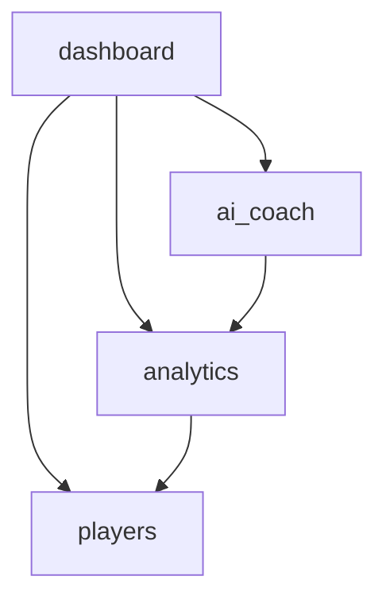

# Architecture

## Overview

ClashCoach AI is structured as four Django apps, each with a distinct responsibility:

- **players** — the only module that talks to the Clash of Clans API. Fetches and caches player data.
- **analytics** — pure Python math. Reads player snapshots and computes progression stats, upgrade gaps, and rankings.
- **ai_coach** — the only module that calls the LLM. Uses analytics output to build prompts and generate roasts/recommendations.
- **dashboard** — assembles data from the three modules above and renders the main UI. Has no models of its own.

## Module flowchart

## TODO

- Add sequence diagrams for the player fetch and roast generation flows.
- Document the NVIDIA NIM API integration.
- Describe the snapshot cooldown mechanism.
